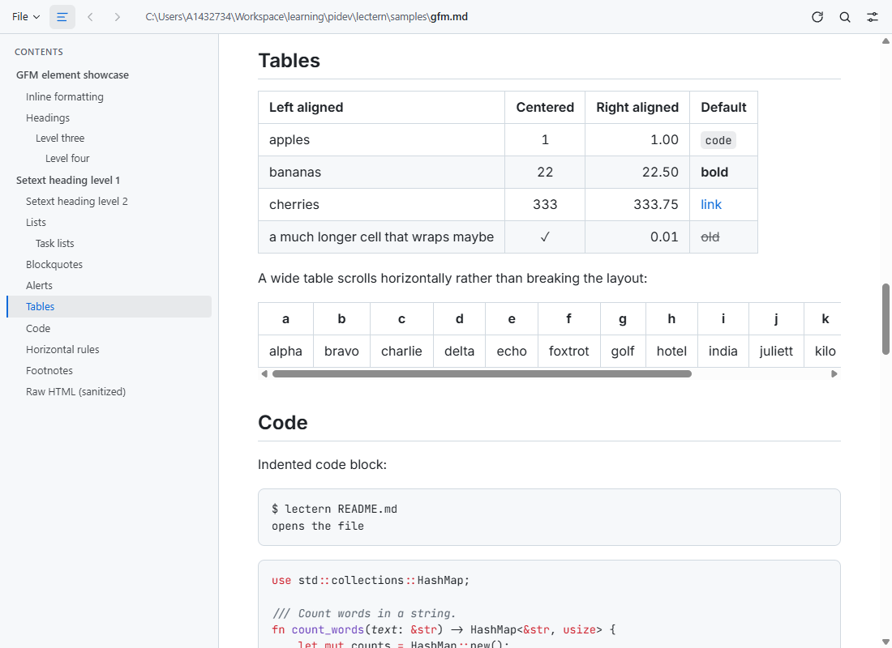
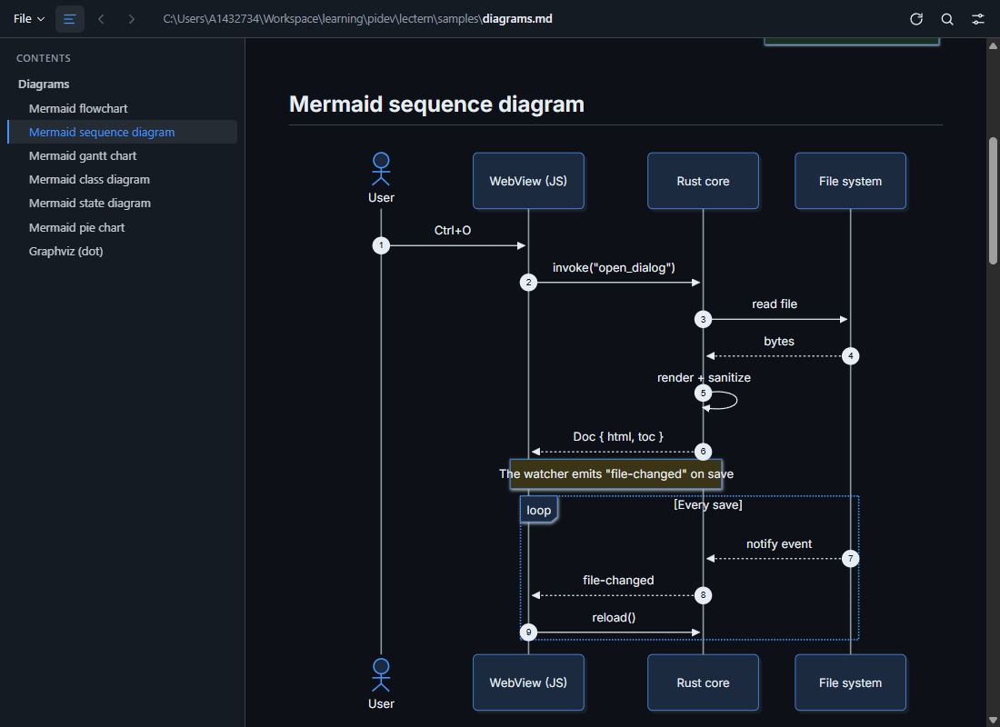

# Lectern

A fast, lightweight, **read-only** Markdown viewer for the desktop. It's built with Tauri v2
and Rust, and the frontend is plain HTML/CSS/JS. It works fully offline: every library and
font is vendored into the repository.

| Light theme, GFM sample | Dark theme, Mermaid diagram |
|---|---|
|  |  |

- GitHub-Flavored Markdown (tables, task lists, strikethrough, autolinks, footnotes, alerts),
  front matter, and sanitized raw HTML
- Syntax highlighting in Rust (syntect) with colours taken from the active theme
- Mermaid diagrams, KaTeX math, Graphviz (`dot`) diagrams. A broken diagram shows an error box
  with its source; it never leaves a blank gap.
- Local images (PNG, JPG, GIF, WebP, SVG) relative to the document, plus remote images and a
  full-size lightbox
- Table of contents with scroll-spy, live reload on save, back/forward navigation between
  linked `.md` files
- Seven theme choices (Light, Dark, Sepia, Solarized Light, Nord, High Contrast, Follow system),
  six bundled text fonts and three code fonts, adjustable size and width
- Find in page, copy buttons on code blocks, print / save as PDF

The primary target is Linux (XFCE/X11, WebKitGTK). It also builds and runs on Windows (WebView2).

---

## Building

### Linux (Debian / Ubuntu)

```sh
# System libraries (WebKitGTK 4.1, GTK 3, and libxdo for Tauri's keyboard handling)
sudo apt update
sudo apt install build-essential curl file pkg-config \
    libwebkit2gtk-4.1-dev libgtk-3-dev libxdo-dev

# Rust 1.85 or newer (edition 2024)
curl --proto '=https' --tlsv1.2 -sSf https://sh.rustup.rs | sh
```

These packages exist on Debian 12+, Ubuntu 22.04+ and their derivatives (Mint, Xubuntu, …).
Fedora: `sudo dnf install webkit2gtk4.1-devel gtk3-devel libxdo-devel`.
Arch: `sudo pacman -S webkit2gtk-4.1 gtk3 xdotool`.

Build and run:

```sh
cd src-tauri
cargo run --release -- ../samples/README.md
```

No Node/npm is needed. There is no frontend build step: `ui/` is embedded into the
binary as-is.

#### Installing

```sh
cargo install --path src-tauri          # installs ~/.cargo/bin/lectern

# Optional: menu entry, icon, and "Open With" for .md files
install -Dm644 packaging/lectern.desktop ~/.local/share/applications/lectern.desktop
install -Dm644 src-tauri/icons/128x128.png ~/.local/share/icons/hicolor/128x128/apps/lectern.png
update-desktop-database ~/.local/share/applications 2>/dev/null || true
xdg-mime default lectern.desktop text/markdown          # make it the default .md viewer
```

To build `.deb` / AppImage packages, use the Tauri CLI: `cargo install tauri-cli --version "^2"`,
then run `cargo tauri build` from the repository root.

### Windows

Install the [Rust toolchain](https://rustup.rs) with the default **MSVC** host and the
*Visual Studio Build Tools* ("Desktop development with C++"). The WebView2 runtime ships
with Windows 10/11. Then:

```powershell
cd src-tauri
cargo run --release -- ..\samples\README.md
```

The `x86_64-pc-windows-gnu` toolchain also works if a MinGW-w64 toolchain (for `windres`)
is on `PATH`. Two GNU-specific notes:

- `WebView2Loader.dll` is copied next to the executable and must be shipped with it.
- The linker prints `.rsrc merge failure: multiple non-default manifests`. This is harmless.
  MinGW always links its own default manifest next to the app's; the app's manifest is the
  one that takes effect.

---

## Usage

```
lectern [FILE.md]
```

You can open a file in four ways:

- pass it on the command line
- **File → Open…** (<kbd>Ctrl</kbd>+<kbd>O</kbd>)
- drag and drop it onto the window
- pick it from **File → Recent files** (the last 10 are remembered)

The header bar shows the full path of the current file; click it to copy the path. The window
title shows the file name. When the file is saved in any editor, the view reloads and keeps
its scroll position. Editors that save by writing a temporary file and renaming it are handled
too.

Links:

- relative links to other Markdown files open in the viewer (`../guide.md#install` works)
- `http(s)` and `mailto` links open in the system browser
- `#anchors` scroll within the document

### Keyboard shortcuts

| Shortcut | Action |
|---|---|
| <kbd>Ctrl</kbd>+<kbd>O</kbd> | Open a file |
| <kbd>Ctrl</kbd>+<kbd>R</kbd> / <kbd>F5</kbd> | Reload |
| <kbd>Ctrl</kbd>+<kbd>P</kbd> | Print / save as PDF |
| <kbd>Ctrl</kbd>+<kbd>F</kbd> | Find in document |
| <kbd>Enter</kbd> / <kbd>Shift</kbd>+<kbd>Enter</kbd>, <kbd>F3</kbd> / <kbd>Shift</kbd>+<kbd>F3</kbd>, <kbd>Ctrl</kbd>+<kbd>G</kbd> | Next / previous match |
| <kbd>Ctrl</kbd>+<kbd>\\</kbd> | Toggle the table of contents |
| <kbd>Ctrl</kbd>+<kbd>Shift</kbd>+<kbd>T</kbd> | Cycle through themes |
| <kbd>Ctrl</kbd>+<kbd>+</kbd> / <kbd>Ctrl</kbd>+<kbd>=</kbd> | Larger text |
| <kbd>Ctrl</kbd>+<kbd>−</kbd> | Smaller text |
| <kbd>Ctrl</kbd>+<kbd>0</kbd> | Reset text size |
| <kbd>Ctrl</kbd>+<kbd>,</kbd> | Appearance settings (theme, fonts, size, width) |
| <kbd>Alt</kbd>+<kbd>←</kbd> / <kbd>Alt</kbd>+<kbd>→</kbd> | Back / forward between linked documents |
| <kbd>Esc</kbd> | Close find bar, popover or image viewer |
| <kbd>Ctrl</kbd>+<kbd>W</kbd> / <kbd>Ctrl</kbd>+<kbd>Q</kbd> | Close the window |

Click an image to view it full size; click again to toggle fit / 100 %.

Printing uses the current theme with its background colours. For paper, switch to a
light theme first.

### Settings

Settings are saved automatically to `config.toml`:

| Platform | Path |
|---|---|
| Linux | `~/.config/lectern/config.toml` (respects `$XDG_CONFIG_HOME`) |
| Windows | `%APPDATA%\lectern\config\config.toml` |
| macOS | `~/Library/Application Support/lectern/config.toml` |

```toml
recent_files = ["/home/me/notes/todo.md"]

[ui]
theme = "system"            # or a theme id: light, dark, sepia, solarized-light, nord, high-contrast
body_font = "inter"         # inter, source-serif-4, literata, atkinson-hyperlegible, ia-writer-quattro, opendyslexic
code_font = "jetbrains-mono" # jetbrains-mono, fira-code, ibm-plex-mono
font_size = 16              # 10–32 px
content_width = "medium"    # narrow, medium, wide, full
toc_open = true

[window]                    # logical pixels; restored only if still on a connected monitor
width = 1100.0
height = 800.0
x = 120.0
y = 80.0
maximized = false
```

A missing file means defaults. A corrupt file never stops the app from starting. Instead:

- every section that still parses is kept, and the rest fall back to defaults
- out-of-range values are clamped
- the bad file is copied to `config.toml.corrupt` so you can inspect it

---

## Adding a theme

Themes are CSS custom properties in [`ui/css/themes.css`](ui/css/themes.css). To add one,
copy an existing block, change the id and the colours, and you're done:

```css
:root[data-theme="gruvbox"] {
  --theme-name: "Gruvbox";      /* label in the settings popover */
  color-scheme: dark;           /* light | dark — also switches Mermaid's dark mode */
  --bg: #282828;
  --fg: #ebdbb2;
  /* … every variable listed at the top of themes.css … */
}
```

The app finds themes by scanning the stylesheet for `:root[data-theme=…]` rules. A new
block automatically appears in the theme picker and the <kbd>Ctrl</kbd>+<kbd>Shift</kbd>+<kbd>T</kbd>
cycle. No JS or Rust changes are needed. Everything else derives from the block:

- **Code highlighting**: Rust emits TextMate scopes as CSS classes (`hl-keyword`, `hl-string`, …).
  [`syntax.css`](ui/css/syntax.css) maps them onto the `--syn-*` variables.
- **Mermaid** is configured from the `--diagram-*`, `--fg`, `--bg` and `--border` variables
  when it renders, and re-renders when the theme changes.
- **Graphviz** output keeps any colours set in the DOT source. Its default black-on-white
  is restyled from `--fg` / `--diagram-fill`.

## Adding a font

1. Put the `.woff2` files in `ui/fonts/<name>/`, along with the licence.
2. Add `@font-face` rules to [`ui/css/fonts.css`](ui/css/fonts.css).
3. Add an entry to `BODY_FONTS` or `CODE_FONTS` in [`ui/js/settings.js`](ui/js/settings.js).

---

## Architecture

```
src-tauri/src/
  render.rs     Markdown → sanitized HTML + TOC (comrak, ammonia). No Tauri dependency.
  slug.rs       GitHub-style heading slugs with de-duplication (foo, foo-1, …)
  highlight.rs  syntect → class-based <span>s (comrak plugin)
  config.rs     config.toml load/save; lenient parsing, atomic writes
  watcher.rs    notify-based watcher (watches the parent directory), debounced
  lib.rs        Tauri app: commands, `mdfile:` image protocol, window geometry, drag & drop
ui/
  index.html, css/, js/   vanilla ES modules; no bundler
  vendor/                 mermaid, katex, @hpcc-js/wasm-graphviz (loaded lazily)
  fonts/                  bundled OFL fonts
```

**Rust** owns file I/O, watching, rendering, sanitizing, TOC extraction and settings.
It exposes these Tauri commands: `startup`, `open_path`, `open_dialog`, `open_link`, `reload`,
`recent_files`, `clear_recent`, `save_settings`, `open_external`, `print`, `close_window`, `ready`.
It also emits these events: `file-changed`, `open-file` (drag & drop) and `drag-state`.

**JavaScript** owns presentation:

- injecting the HTML
- KaTeX, Mermaid and Graphviz post-processing
- the TOC and scroll-spy
- themes and fonts
- find, the lightbox, and keyboard shortcuts

### Security model

- **All document HTML is sanitized** by ammonia with an explicit allowlist. That removes
  `<script>`, `<style>`, `<iframe>`, `<form>`, event handlers, and `javascript:` URLs, and
  allows `data:` URLs only on images. Raw HTML in Markdown is still supported within that
  allowlist.
- **Strict CSP.** `script-src 'self' 'wasm-unsafe-eval'`, so only the app's own vendored
  scripts run. `'wasm-unsafe-eval'` is needed by the Graphviz WebAssembly module.
  `object-src`, `frame-src` and `form-action` are `'none'`.
- **Images** are served through a custom `mdfile:` protocol, not a filesystem scope. It only
  serves files that the *currently open* document references, and only with image MIME
  types. Nothing else on disk is reachable.
- **Third-party output.** Mermaid runs with `securityLevel: "strict"`. Graphviz SVG output
  is sanitized again in JS before insertion.
- **No plugin permissions in JS.** File dialogs and opening URLs go through Rust commands.
  `open_external` only accepts `http`, `https` and `mailto`.

---

## Development

```sh
cd src-tauri
cargo test                          # unit tests: rendering, slugs, TOC, sanitizing, config, watcher, image protocol
cargo clippy --all-targets -- -D warnings
cargo fmt --check
```

[`samples/`](samples/README.md) exercises every feature:

- every GFM element
- Mermaid flowchart, sequence, gantt, class, state and pie diagrams
- Graphviz and math
- relative, `../` and remote images
- duplicate headings
- a long document for scroll-spy
- deliberately broken diagrams
- XSS attempts

Vendored libraries and fonts are committed. To update them, edit the versions in
[`scripts/vendor.sh`](scripts/vendor.sh) and run it (it needs `curl`). App icons are generated by
[`scripts/make_icons.py`](scripts/make_icons.py) (needs Pillow).

### Troubleshooting

- **Blank or white window on Linux** (some GPU drivers, especially NVIDIA): run with
  `WEBKIT_DISABLE_DMABUF_RENDERER=1 lectern file.md`.
- **Remote images don't load**: they need network access. Local images and all diagrams,
  math and fonts work offline.

## Third-party components

| Component | Licence |
|---|---|
| [Mermaid](https://github.com/mermaid-js/mermaid) 12.2 | MIT |
| [KaTeX](https://github.com/KaTeX/KaTeX) 0.19 | MIT |
| [@hpcc-js/wasm-graphviz](https://github.com/hpcc-systems/hpcc-js-wasm) 1.29 (Graphviz) | Apache-2.0 (Graphviz: EPL-1.0) |
| Inter, Source Serif 4, Literata, Atkinson Hyperlegible, iA Writer Quattro, OpenDyslexic, JetBrains Mono, Fira Code, IBM Plex Mono | SIL Open Font License 1.1 |

Licence texts are next to the files in `ui/vendor/*/LICENSE` and `ui/fonts/*/OFL.txt`.
