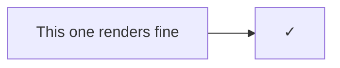

# Broken things

Every failure here should be visible and explained, never a blank gap.

## Broken Mermaid (syntax error)

```mermaid
flowchart LR
    A --> B
    B --> (oops this is not valid
    C -->
```

## Broken Mermaid (unknown diagram type)

```mermaid
notADiagram
    foo --> bar
```

## Empty Mermaid block

```mermaid
```

## Broken Graphviz

```dot
digraph {
    a -> b
    b -> [
}
```

## Broken math

Inline: $\frac{1}{$ and $\notacommand{x}$ keep the surrounding text intact.

$$
\begin{matrix} a & b \\ c
$$

## Missing images


## Dead links

- [A Markdown file that doesn't exist](missing.md)
- [A non-Markdown local file](images/diagram.png)
- [An anchor that doesn't exist](#nowhere)
- [An unsupported scheme](ftp://example.com/file)

## Still working after all that


