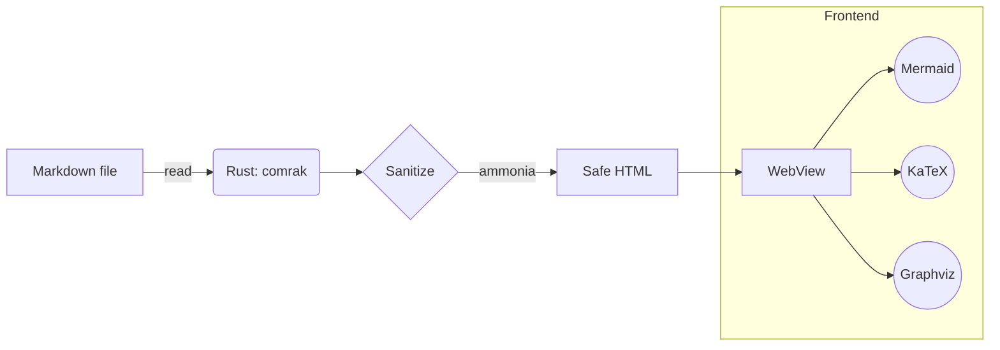
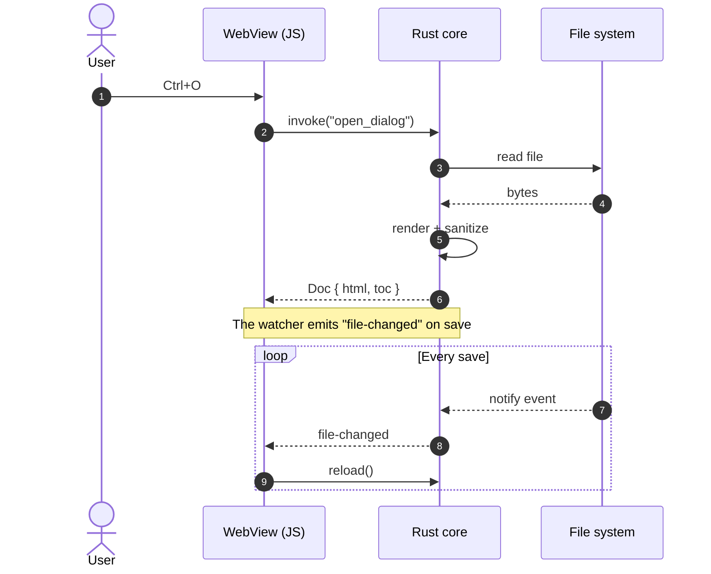
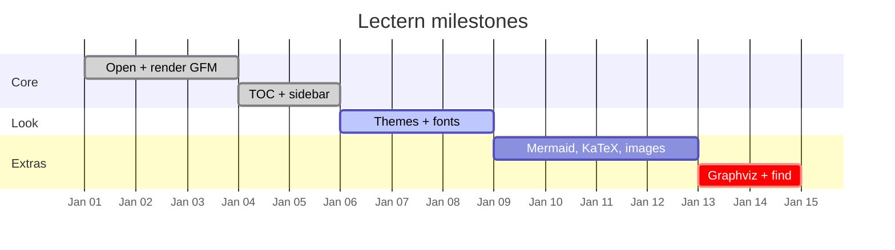
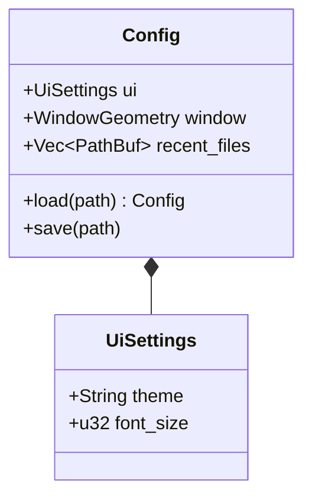
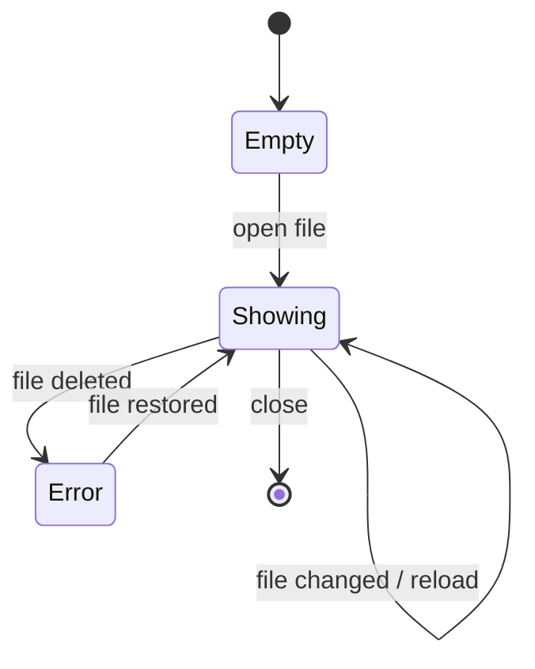
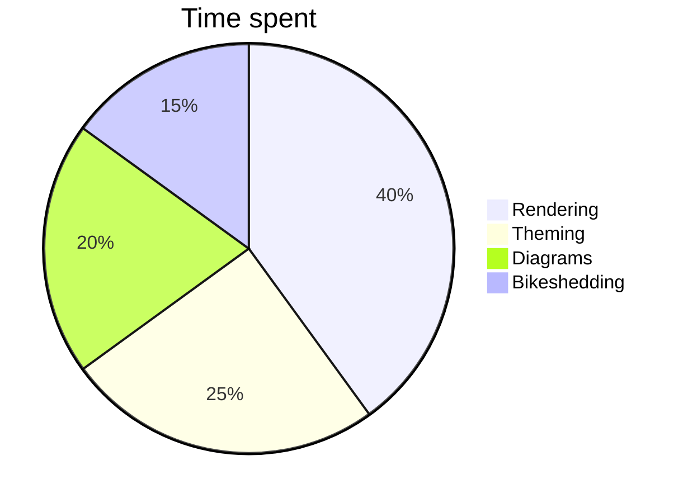
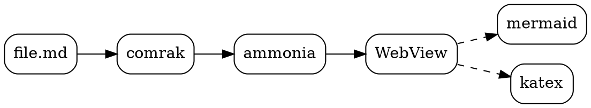
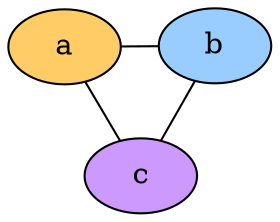

# Diagrams

Mermaid and Graphviz render from fenced code blocks. Switch themes with
<kbd>Ctrl</kbd>+<kbd>Shift</kbd>+<kbd>T</kbd>: diagram colours follow. Broken diagrams live in
[broken.md](broken.md).

## Mermaid flowchart

## Mermaid sequence diagram

## Mermaid gantt chart

## Mermaid class diagram

## Mermaid state diagram

## Mermaid pie chart

## Graphviz (dot)

Graphviz with explicit colours (these are kept as written):

