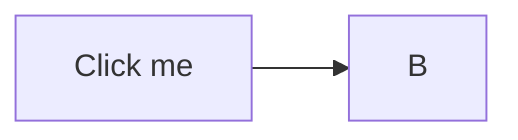

# Security

Everything below tries to run script or escape the sandbox. With sanitizing (ammonia)
and the CSP, none of it should do anything. Each attempt is described in plain text so
you can check what was removed.

1. A `

2. An `onerror` handler on an image (attribute removed; shows as a broken image):

3. A `javascript:` link (href removed): <a href="javascript:alert('PWNED')">click me</a>
and in Markdown form: [click me too](javascript:alert('PWNED'))

4. An inline event handler on a div (removed):

Hover me

5. An iframe (removed): <iframe src="https://example.com"></iframe>

6. A style element that would hide the page (removed):

7. A `data:` URL link (removed): <a href="data:text/html,">data link</a>

8. A form with a text input (the form is removed; the input becomes a disabled checkbox):

<form action="https://example.com"><input type="text" name="q" value="search"><button>Go</button></form>

9. An SVG image with an embedded script (rendered as ``, so the script cannot run):

10. An `<object>` / `<embed>` (removed): <object data="images/logo.svg"></object><embed src="images/logo.svg">

11. Mermaid click callbacks are disabled (`securityLevel: strict`):

12. A `<meta http-equiv="refresh">` (removed): <meta http-equiv="refresh" content="0;url=https://example.com">

13. A `<base>` tag that would hijack relative links (removed): <base href="https://evil.example/">

If the page still shows this text and no alert ever appeared, the sanitizer did its job.
